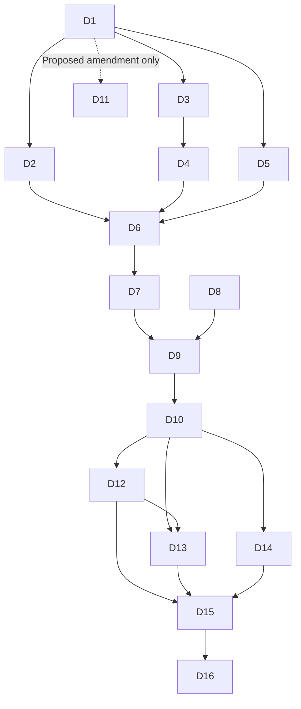

# D1-D16 acceptance register - November 4, 2026

Software verification is complete within its stated scope. Scientific acceptance and genuine 16/16 completion are not established. The machine-readable companion is [progress.json](progress.json).

| Task | Status | Implemented / verified | Remaining acceptance | Responsibility |
| --- | --- | --- | --- | --- |
| D1 | IN PROGRESS | Approved paper and current interfaces reconciled; transformer divergence isolated | Signed branch-specific source/feature/evaluation decisions and title disposition | Researchers/adviser |
| D2 | IN PROGRESS | Existing preprocessing retained; numeric overflow rejection repaired | Real source screening/lineage and accepted no-regeneration input path | Dhanwil; source custodian for provenance |
| D3 | IN PROGRESS | Eight raw/clean source pairs hashed/header-inspected; four historical metadata manifests checked | Original-ID attrition, license/access, class semantics and eligibility acceptance | Vera/source custodian and researchers |
| D4 | BLOCKED | Zero supplied group crossings found in four historical manifests | Accepted complete relationships and exposure-aware custody/split reuse | Researchers/adviser |
| D5 | IN PROGRESS | Canonical 12 indicators/4 dimensions and U1 unavailability preserved | Frozen operational rule/locator/language/availability conformance; runtime experiment reconciliation | Vera/researchers for specification; Dhanwil for mechanics |
| D6 | IN PROGRESS | Matched ID/feature/fold and availability contracts exercised synthetically | Accepted actual development inputs and dataset-to-feature conformance | Dhanwil with source/specification owners |
| D7 | IN PROGRESS | Source confounding and historical exposure documented; slice/paired-control checks implemented | Source/duplicate/calibration leakage evidence on accepted inputs | Researchers/adviser; Dhanwil audits |
| D8 | COMPLETE | Available Python/frontend tests, TypeScript checks, production builds and notebook syntax passed | Maintain passing checks after future changes; does not establish research validity | Dhanwil |
| D9 | IN PROGRESS | Strict D9/branch/UCI handoff contracts preserved; fixed hashes and exclusive synthetic bundles | Accepted real dictionary, population and delivery records; real handoff authorization | Dhanwil and research acceptance owners |
| D10 | IN PROGRESS | Synthetic grouped CV runner with four family slots; no real estimator factories or research fits | Approved data/settings, isolated scientific environment, genuine factories/tuning and research execution | Dhanwil after researchers/adviser freeze |
| D11 | PENDING | Transformer feasibility/amendment proposal prepared; no architecture adopted | Choose title alignment or explicit amendment; independent labels needed only for supervised behavioral claim | Researchers/adviser |
| D12 | IN PROGRESS | Binary metrics/reliability/paired group bootstrap implemented and analytically tested | Accepted probability/metric conventions and real predictions/calibration; no fitted calibrator | Dhanwil; researchers freeze conventions |
| D13 | IN PROGRESS | Matched CV, four dimension omissions, explicit family omissions and paired differences prepared | Approved real CV/ablation/sensitivity execution and uncertainty/score policy | Dhanwil after protocol decisions |
| D14 | IN PROGRESS | Input/code/output hashes, environment and exclusive replayable synthetic bundle saved | Pinned scientific environment, actual accepted source/model/selection artifact versions | Dhanwil; researchers accept freeze |
| D15 | IN PROGRESS | Manuscript evidence/limitations and per-finding categories documented | Empirical conclusions from authorized experiments; no synthetic thesis-performance claims | Dhanwil/Vera |
| D16 | IN PROGRESS | Final audit, artifact index, progress/decision handoff prepared | All scientific gates and final compatible model/calibration/risk/system freeze | Researchers/adviser; Dhanwil technical release |

The dependency graph describes research evidence acceptance. Generic software and synthetic tests may proceed before upstream research decisions. D11's proposed amendment is an optional branch and is not a prerequisite to approved deterministic experiments.

